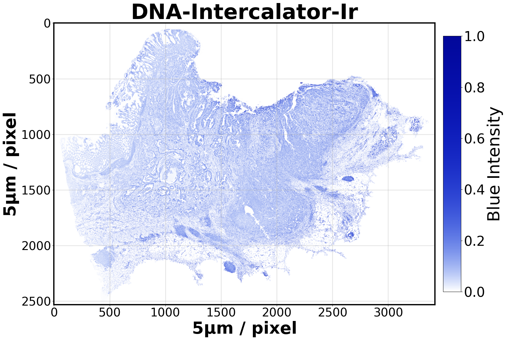
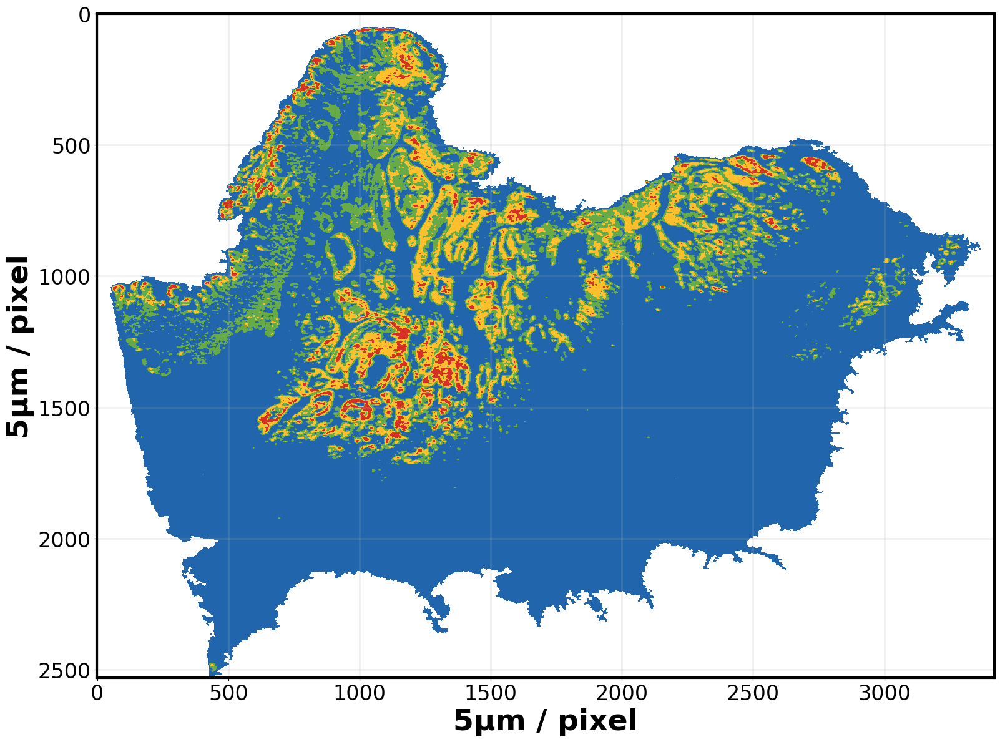

<p align="left"></p>

[](https://pypi.org/project/IMC-HistoTools)
[](https://pypi.org/project/IMC-HistoTools)
[](https://opensource.org/licenses/MIT)

**IMC-HistoTools** is a digital-pathology toolkit that bridges **imaging mass cytometry (IMC)** and **histopathology**, developed for the Selenium (Se) IMC study. It turns raw IMC channels into brightfield-like virtual IHC images, quantifies marker expression as **pixel-wise H-scores** on Qupath annotations, and renders **three-color virtual IHC** images from registered channels.

# Functionality

| Function | Description |
| --- | --- |
| `virtual_IHC` | Synthesise an IHC / brightfield-like RGB image from IMC channels using the Beer–Lambert absorbance model (per-channel gamma, background threshold, stain colour bar). |
| `virtual_IHC_ROI` | Same as above but zooms into a local region while **keeping the original pixel coordinates**. |
| `virtual_IHC_annotation` | Rasterise Qupath `.geojson` polygon annotations into ROI boolean masks. |
| `Hscore_threshold` | Build classification thresholds from reference ROIs (Low / Medium / High; Negative optional) using **mean / median / geometric-mean / all**. |
| `pix_Hscore_plot_map` | Draw a pixel-wise NP / LP / MP / HP classification color map from a marker image and thresholds (optional Gaussian blur for display). |
| `pix_Hscore_plot_bar` | Draw a per-region pix H-score bar chart plus an NP / LP / MP / HP proportion table. |

# Install IMC-HistoTools

### Using pip [](https://pypi.org/project/IMC-HistoTools)
```console
pip install IMC-HistoTools
```

### From GitHub [](https://github.com/gjhan100/IMC-HistoTools)
```console
git clone https://github.com/gjhan100/IMC-HistoTools.git
cd IMC-HistoTools
pip install -e .
```

# Usage

<details>
<summary><strong>1. Virtual IHC from IMC raw tiff</strong></summary>

Render a brightfield-like IHC image from raw (or [0,1]-normalised) IMC channels.
`Blue` is typically the nuclear marker (DNA); `Brown` / `Red` are membrane / lineage markers.
The example below renders the DNA intercalator channels (¹⁹¹Ir + ¹⁹³Ir) as a blue virtual IHC image.

```python
import numpy as np
import tifffile
from pathlib import Path
from IMC_HistoTools import virtual_IHC, virtual_IHC_ROI

# read IMC channels
DNA_CRC1 = tifffile.imread("ROI_001_191Ir-DNA191_Ir191_crop_normal.tiff").astype(np.float32)
DNA_CRC2 = tifffile.imread("ROI_001_193Ir-DNA193_Ir193_crop_normal.tiff").astype(np.float32)
Se_Ecadherin = tifffile.imread("ROI_001_Se_crop_normal.tiff").astype(np.float32)  # for the axis extent
out_dir = Path("out")

# virtual IHC from DNA-Intercalator-Ir
fig = virtual_IHC(Blue_image=DNA_CRC1 + DNA_CRC2,
                  Red_image=None,
                  Brown_image=None,
                  blue_name="DNA", brown_name="E-cadherin (Se)",
                  brown_threshold=0.1,
                  title="DNA-Intercalator-Ir",
                  sigma=1, kernel_size=(3, 3),
                  k1=0.25, k3=0.5,
                  figsize=(24, 12),
                  grid=True,
                  grid_linewidth=2.0,
                  spine_linewidth=3.0,
                  tick_fontsize=28,
                  axis_label_fontsize=40,
                  bar_tick_fontsize=32,
                  axis_label_fontweight='bold',
                  tick_fontweight='normal',
                  bar_tick_fontweight='normal',
                  title_fontsize=50,
                  title_fontweight='bold',
                  tick_step=500, xlim=(0, Se_Ecadherin.shape[1]), ylim=(0, Se_Ecadherin.shape[0]),
                  blue_bar=True,
                  save_dir=str(out_dir / "CRC_virtual_IHC.png"),
                  Save_raw=True,
                  save_dpi=300)
```

<p align="center"></p>

A local region can be rendered while keeping the original pixel coordinates with `virtual_IHC_ROI`:

```python
virtual_IHC_ROI(
    Blue_image=DNA_CRC1 + DNA_CRC2, Red_image=None, Brown_image=None,
    X0=2250, X1=3000, Y0=1250, Y1=2000, TICK=250,
    save_dir="out/virtual_IHC_ROI.png",
)
```
</details>

<details>
<summary><strong>2. Pixel-wise H-score with Qupath annotation</strong></summary>

Load tissue-region and reference-ROI annotations exported from Qupath, calibrate the
thresholds from the Low / Medium / High reference ROIs, then classify every pixel and
plot the classification map and the per-region bar chart + table.

```python
import numpy as np
import tifffile
from pathlib import Path
from IMC_HistoTools import (virtual_IHC_annotation, Hscore_threshold,
                            pix_Hscore_plot_map, pix_Hscore_plot_bar, BAR_ORDER)

out_dir = Path("out")
marker = tifffile.imread("Normalize/ROI_001_Se_crop_normal.tiff").astype(np.float32)
tissue = tifffile.imread("Mask/mask_crop.tiff") > 0

# 1) tissue-region annotations (Normal mucosa / Tumor center / Invasive front / ...)
ann = virtual_IHC_annotation(marker, "tissue_regions.geojson", regions=None)

# 2) reference ROIs (Low / Medium / High) for threshold calibration
ref = virtual_IHC_annotation(marker, "reference_ROIs.geojson")   # default: Low/Medium/High

# 3) thresholds from the reference ROIs  (stat: 'mean'/'median'/'geomean'/'all')
thr = Hscore_threshold(
    marker,
    Lp=ref["masks"]["Low"], Mp=ref["masks"]["Medium"], Hp=ref["masks"]["High"],
    tissue_mask=tissue, stat="median",
)
print(thr["thresholds"])          # (Lp, Mp, Hp)

# 4) pixel-wise classification
T1, T2, T3 = thr["thresholds"]
scores = np.select([marker >= T3, marker >= T2, marker >= T1], [3, 2, 1], default=0).astype(np.uint8)

def region_pix_hscore(mask):
    sc = scores[mask]; total = int(sc.size)
    counts = {k: int((sc == k).sum()) for k in (0, 1, 2, 3)}
    pix_h = 100.0 * (3*counts[3] + 2*counts[2] + counts[1]) / total if total else 0.0
    percents = {k: (100.0*v/total if total else 0.0) for k, v in counts.items()}
    return {"pix_h": pix_h, "counts": counts, "percents": percents,
            "total": total, "valid_px": int(mask.sum())}

results = {n: region_pix_hscore(ann["masks"][n] & tissue) for n in ann["names"]}

# 5) classification map
fig_map = pix_Hscore_plot_map(
    marker,
    thr["thresholds"],              # (T1, T2, T3) = (Lp, Mp, Hp)
    tissue_mask=tissue,             # set background to white
    blur_sigma=5,
    blur_kernel=(7, 7),
    grid=True,
    colorbar=False,
    grid_linewidth=2.0,
    spine_linewidth=3.0,
    figsize=(18, 12),
    xlabel="5μm / pixel",
    ylabel="5μm / pixel",
    save_path=str(out_dir / "CRC_T2_map_example.png"),
    dpi=200,
    show=True,
)

# 6) bar chart + proportion table
fig_bar = pix_Hscore_plot_bar(
    results,
    bar_order=BAR_ORDER,
    figsize=(6, 6),
    bar_title="pix H-scores", bar_title_pad=10,
    title_fontsize=20, title_fontweight="bold",
    tick_fontsize=16, tick_fontweight="bold",
    value_fontsize=22,
    table_fontsize=17,
    overall_fontsize=12,
    overall_hscore=None,             # pass the overall tissue pix H-score to draw a reference line
    save_path=str(out_dir / "CRC_T2_bar_example.png"),
    dpi=200,
    show=True,
)
```

<p align="center"></p>
<p align="center"></p>

Classification: `intensity < Lp` → 0 (NP), `[Lp, Mp)` → 1 (LP), `[Mp, Hp)` → 2 (MP),
`>= Hp` → 3 (HP). The bar-chart statistics always use the **non-blurred** classification.
</details>

<details>
<summary><strong>3. Three-color virtual IHC</strong></summary>

Combine three registered channels — DNA (blue), a lineage marker (red), and a membrane marker (brown) — into a single three-color virtual IHC image. The example renders Keratin 8/18 (brown), αSMA-Se (red), and DNA-intercalator (blue) from an HCC section, as introduced in Tutorial 3.

```python
import numpy as np
import tifffile
from pathlib import Path
from IMC_HistoTools import virtual_IHC

input_dir = Path("05_background_correction")
output_dir = Path("06_virtual_IHC")
αSMA = tifffile.imread(input_dir / "ROI_001_Se_aSMA_cor.tiff").astype(np.float32)
DNA_1 = tifffile.imread(input_dir / "ROI_001_191Ir-DNA_Ir191_cor.tiff").astype(np.float32)
DNA_2 = tifffile.imread(input_dir / "ROI_001_193Ir-DNA_Ir193_cor.tiff").astype(np.float32)
marker = tifffile.imread(input_dir / "ROI_001_174Yb-Keratin8-18_Yb174_cor.tiff").astype(np.float32)

# ---- Virtual IHC (HCC) ----
fig = virtual_IHC(Blue_image=DNA_1+DNA_2, Red_image=αSMA, Brown_image=marker,
                  blue_name="DNA", brown_name="Keratin8-18", red_name="αSMA",
                  red_threshold=0.1,
                  brown_threshold=0,
                  title="Keratin 8/18-174Yb (brown) αSMA-Se (red)",
                  xlabel='5μm / pixel',
                  ylabel='',
                  sigma=1, kernel_size=(3, 3),
                  k1=0.15, k2=0.15, k3=0.25,
                  figsize=(12, 6.8),
                  tick_step=500, xlim=(0, αSMA.shape[1]), ylim=(0, αSMA.shape[0]),
                  tick_fontsize=14,
                  tick_fontweight='normal',
                  axis_label_fontsize=18,
                  axis_label_fontweight='bold',
                  title_fontsize=28,
                  title_fontweight='bold',
                  title_pad=14,
                  bar_pad=0.01,
                  brown_bar=True,
                  bar_spacing=0.15,
                  red_bar_depth=1.0,
                  brown_bar_label='Keratin 8/18',
                  bar_fraction=0.02453,
                  bar_shrink=0.93,
                  bar_label_fontsize=28,
                  bar_label_fontweight='bold',
                  bar_tick_fontsize=14,
                  save_dir=str(output_dir / "αSMA_174Yb-Keratin8-18.png"),
                  Save_raw=True,
                  save_dpi=300)
```

<p align="center"></p>
</details>

# Citation

If you use **IMC-HistoTools** in your research, please cite the Se IMC paper (citation
to be added upon publication).

# License

This project is licensed under the **MIT License** — see the [LICENSE](LICENSE) file.
