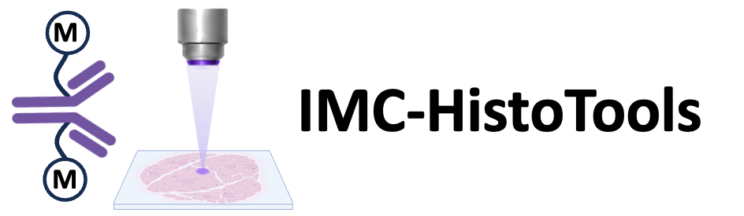

<p align="center"></p>

[](https://pypi.org/project/IMC-HistoTools)
[](https://pypi.org/project/IMC-HistoTools)
[](https://opensource.org/licenses/MIT)

**IMC-HistoTools** is a digital-pathology toolkit that bridges **imaging mass cytometry (IMC)** and **histopathology**, developed for the Selenium (Se) IMC study. It turns raw IMC channels into brightfield-like virtual IHC images, quantifies marker expression as **pixel-wise H-scores** on Qupath annotations, and renders **virtual multiplex** images from consecutive sections.

# Functionality

| Function | Description |
| --- | --- |
| `virtual_IHC` | Synthesise an IHC / brightfield-like RGB image from IMC channels using the Beer–Lambert absorbance model (per-channel gamma, background threshold, stain colour bar). |
| `virtual_IHC_ROI` | Same as above but zooms into a local region while **keeping the original pixel coordinates**. |
| `virtual_IHC_annotation` | Rasterise Qupath `.geojson` polygon annotations into ROI boolean masks. |
| `Hscore_threshold` | Build classification thresholds from reference ROIs (Negative / Low / Medium / High) using **mean / median / geometric-mean / all**. |
| `pix_Hscore_map` | Classify every pixel into NP / LP / MP / HP, export a per-pixel CSV, and produce publication figures (classification map + bar chart & table). |

# Install IMC-HistoTools

### Using pip [](https://pypi.org/project/IMC-HistoTools)
```console
pip install IMC-HistoTools
```

### From GitHub [](https://github.com/gjhan100/IMC-HistoTools)
```console
git clone https://github.com/gjhan100/IMC-HistoTools.git
cd IMC-HistoTools
pip install -e .
```

# Usage

<details>
<summary><strong>1. Virtual IHC from IMC raw tiff</strong></summary>

Render a brightfield-like IHC image from raw (or [0,1]-normalised) IMC channels.
`Blue` is typically the nuclear marker (DNA); `Brown`/`Red` are membrane / lineage markers.

```python
import numpy as np
import tifffile
from IMC_HistoTools import virtual_IHC, virtual_IHC_ROI

# read IMC channels
dna = tifffile.imread("ROI_001_193Ir-DNA_cor.tiff").astype(np.float32)   # nuclear
se  = tifffile.imread("ROI_001_Se-Ecadherin_cor.tiff").astype(np.float32) # membrane

# full-image virtual IHC  (Blue = DNA, Brown = E-cadherin-Se)
virtual_IHC(
    Blue_image=dna, Red_image=None, Brown_image=se,
    blue_name="DNA", brown_name="E-cadherin (Se)",
    brown_threshold=0.1,          # background removal (< threshold -> 0)
    brown_bar=True,               # show stain colour bar
    save_dir="out/virtual_IHC.png",
)

# local region, keeping original pixel coordinates
virtual_IHC_ROI(
    Blue_image=dna, Red_image=None, Brown_image=se,
    X0=2250, X1=3000, Y0=1250, Y1=2000, TICK=250,
    save_dir="out/virtual_IHC_ROI.png",
)
```
</details>

<details>
<summary><strong>2. Pixel-wise H-score with Qupath annotation</strong></summary>

Load tissue-region and reference-ROI annotations exported from Qupath, calibrate the
thresholds from the Negative / Low / Medium / High reference ROIs, then classify every
pixel and export a CSV + figures.

```python
from IMC_HistoTools import virtual_IHC_annotation, Hscore_threshold, pix_Hscore_map

marker = tifffile.imread("Normalize/ROI_001_Se_crop_normal.tiff").astype(np.float32)
tissue = tifffile.imread("Mask/mask_crop.tiff") > 0

# 1) tissue-region annotations (Normal mucosa / Tumor center / Invasive front / ...)
ann = virtual_IHC_annotation(marker, "tissue_regions.geojson")

# 2) reference ROIs (Negative / Low / Medium / High) for threshold calibration
ref = virtual_IHC_annotation(marker, "reference_ROIs.geojson",
                             region_order=["Negative", "Low", "Medium", "High"])

# 3) thresholds from the reference ROIs  (stat: 'mean'/'median'/'geomean'/'all')
thr = Hscore_threshold(
    marker,
    Np=ref["masks"]["Negative"], Lp=ref["masks"]["Low"],
    Mp=ref["masks"]["Medium"],   Hp=ref["masks"]["High"],
    tissue_mask=tissue, stat="median",
)
print(thr["thresholds"])          # (Lp, Mp, Hp)

# 4) per-pixel H-score map + CSV + bar chart / table
res = pix_Hscore_map(
    marker,
    Hscore_threshold_annotation=ref["masks"],   # Lp / Mp / Hp reference ROIs
    tissue_annotation=ann["masks"],             # non-empty -> bar chart + table
    tissue_mask=tissue,
    stat="median",
    delta=2, kernel=(5, 5),                     # Gaussian blur for the map display only
    save_dir="out/",
)
res["csv_path"]        # per-pixel classification: x, y, intensity, score, category
```

Classification: `intensity < Lp` → 0 (NP), `[Lp, Mp)` → 1 (LP), `[Mp, Hp)` → 2 (MP),
`>= Hp` → 3 (HP). The bar-chart statistics always use the **non-blurred** classification.
</details>

<details>
<summary><strong>3. Virtual multiplexing from consecutive sections</strong></summary>

Feed registered channels from consecutive sections into the three colour channels of
`virtual_IHC` to obtain a single virtual-multiplex image (blue / red / brown).

```python
from IMC_HistoTools import virtual_IHC

virtual_IHC(
    Blue_image=dna,     # section A — DNA        (nuclear,    blue)
    Red_image=cd45,     # section B — CD45       (red)
    Brown_image=ecad,   # section C — E-cadherin (membrane,   brown)
    blue_name="DNA", red_name="CD45", brown_name="E-cadherin",
    blue_bar=True, red_bar=True, brown_bar=True,
    save_dir="out/virtual_multiplex.png",
)
```
</details>

# Citation

If you use **IMC-HistoTools** in your research, please cite the Se IMC paper (citation
to be added upon publication).

# License

This project is licensed under the **MIT License** — see the [LICENSE](LICENSE) file.
