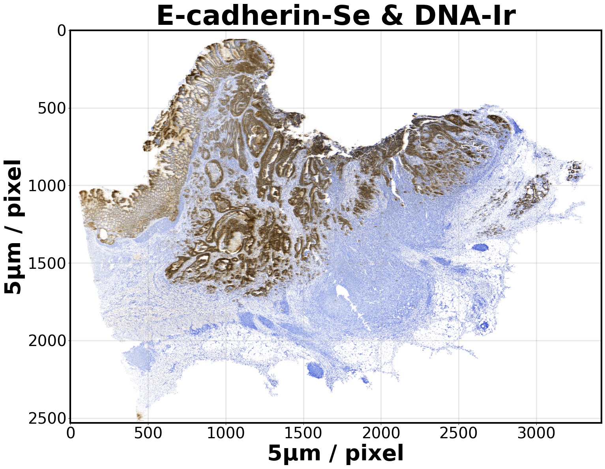
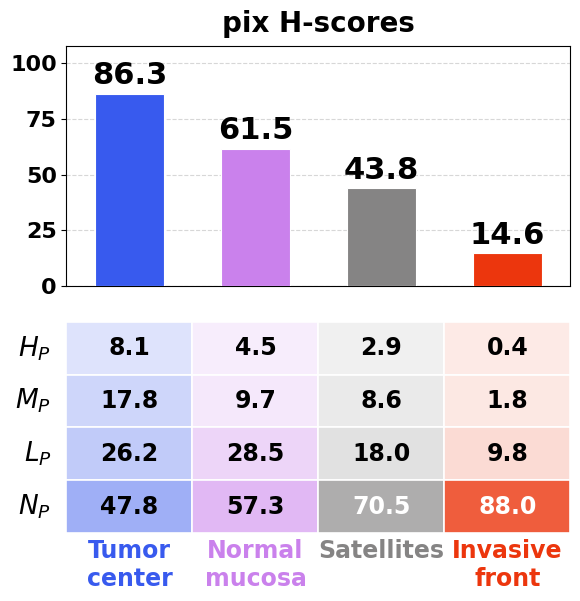
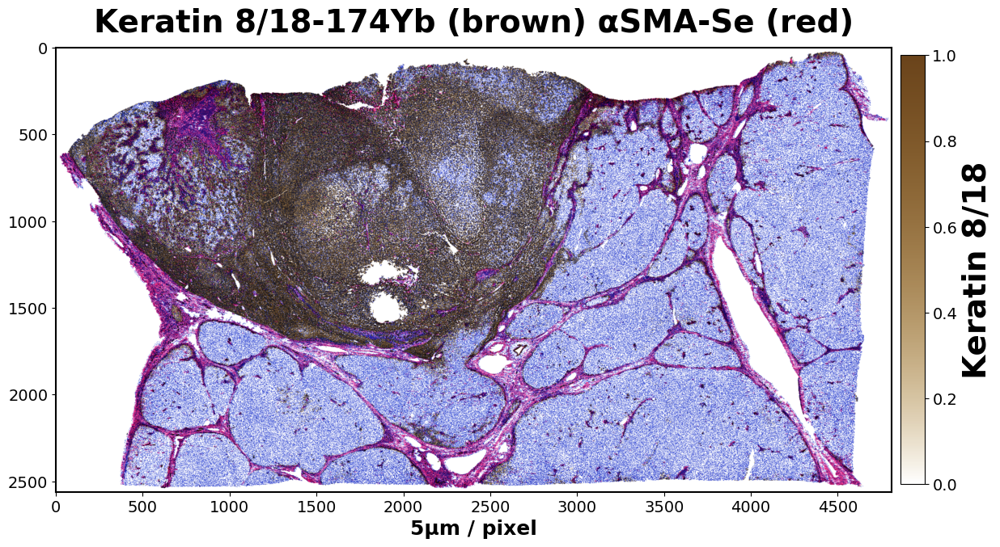

<p align="left"></p>

[](https://pypi.org/project/IMC-HistoTools)
[](https://pypi.org/project/IMC-HistoTools)
[](https://opensource.org/licenses/MIT)

**IMC-HistoTools** is a digital-pathology toolkit that bridges **imaging mass cytometry (IMC)** and **histopathology**, developed for the Selenium (Se) IMC study. It turns raw IMC channels into brightfield-like virtual IHC images, quantifies marker expression as **pixel-wise H-scores** on Qupath annotations, and renders **three-color virtual IHC** images from registered channels.

# Functionality

| Function | Description |
| --- | --- |
| `virtual_IHC` | Synthesise an IHC / brightfield-like RGB image from IMC channels using the Beer–Lambert absorbance model (per-channel gamma, background threshold, stain colour bar). |
| `virtual_IHC_ROI` | Same as above but zooms into a local region while **keeping the original pixel coordinates**. |
| `virtual_IHC_annotation` | Rasterise Qupath `.geojson` polygon annotations into ROI boolean masks. |
| `Hscore_threshold` | Build classification thresholds from reference ROIs (Low / Medium / High; Negative optional) using **mean / median / geometric-mean / all**. |
| `pix_Hscore_plot_map` | Draw a pixel-wise NP / LP / MP / HP classification color map from a marker image and thresholds (optional Gaussian blur for display). |
| `pix_Hscore_plot_bar` | Draw a per-region pix H-score bar chart plus an NP / LP / MP / HP proportion table. |

# Install IMC-HistoTools

### Using pip [](https://pypi.org/project/IMC-HistoTools)
```console
pip install IMC-HistoTools
```

### From GitHub [](https://github.com/gjhan100/IMC-HistoTools)
```console
git clone https://github.com/gjhan100/IMC-HistoTools.git
cd IMC-HistoTools
pip install -e .
```

# Usage

Full runnable examples are provided as Jupyter notebooks in [`Tutorial/`](Tutorial/).

<details>
<summary><strong>1. Virtual IHC from IMC raw tiff (tutorial 1)</strong></summary>

Render a brightfield-like IHC image from raw (or [0,1]-normalised) IMC channels.
`Blue` is typically the nuclear marker (DNA); `Brown` / `Red` are membrane / lineage markers.
The example below renders E-cadherin (Se) in brown together with the DNA intercalator (¹⁹¹Ir + ¹⁹³Ir) in blue.

<p align="center"></p>

See [`Tutorial/261107_Tutorial1_IMC_HistoTools_CRC_virIHC.ipynb`](Tutorial/261107_Tutorial1_IMC_HistoTools_CRC_virIHC.ipynb) for the full code.
</details>

<details>
<summary><strong>2. Pixel-wise H-score with Qupath annotation (tutorial 2)</strong></summary>

Load tissue-region and reference-ROI annotations exported from Qupath, calibrate the thresholds from the Low / Medium / High reference ROIs, classify every pixel into NP / LP / MP / HP, and plot the classification map and the per-region bar chart + proportion table.

<p align="center"></p>
<p align="center"></p>

See [`Tutorial/261107_Tutorial2_IMC_HistoTools_CRC_pixHscore.ipynb`](Tutorial/261107_Tutorial2_IMC_HistoTools_CRC_pixHscore.ipynb) for the full code.
</details>

<details>
<summary><strong>3. Three-color virtual IHC (tutorial 3)</strong></summary>

Combine three registered channels — DNA (blue), a lineage marker (red), and a membrane marker (brown) — into a single three-color virtual IHC image. The example renders Keratin 8/18 (brown), αSMA-Se (red), and DNA-intercalator (blue) from an HCC section.

<p align="center"></p>

See [`Tutorial/261107_Tutorial3_IMC_HistoTools_HCC_virIHC.ipynb`](Tutorial/261107_Tutorial3_IMC_HistoTools_HCC_virIHC.ipynb) for the full code.
</details>

# Citation

If you use **IMC-HistoTools** in your research, please cite the Se IMC paper (citation
to be added upon publication).

# License

This project is licensed under the **MIT License** — see the [LICENSE](LICENSE) file.
